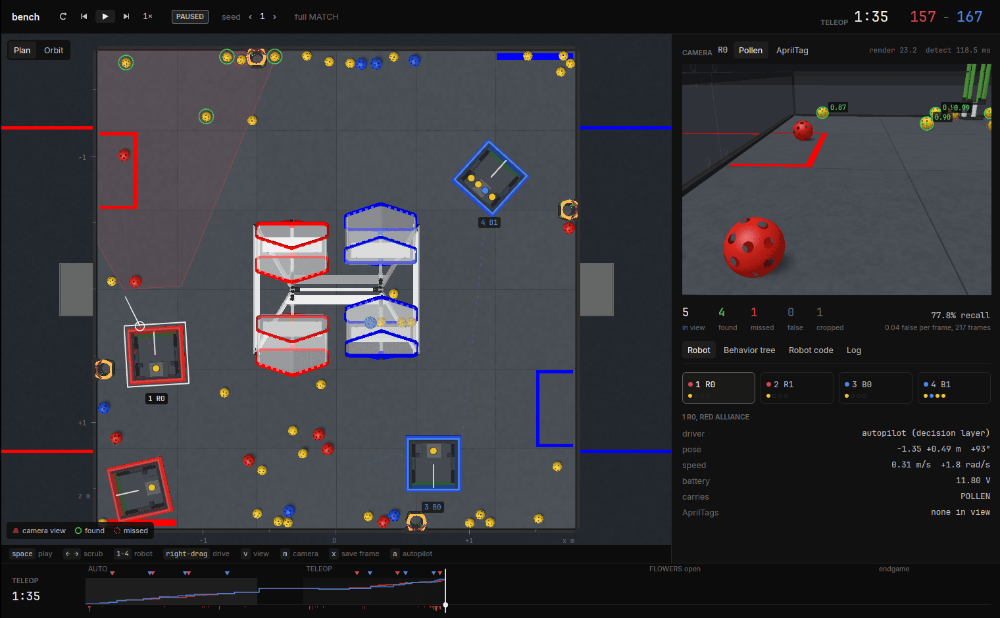
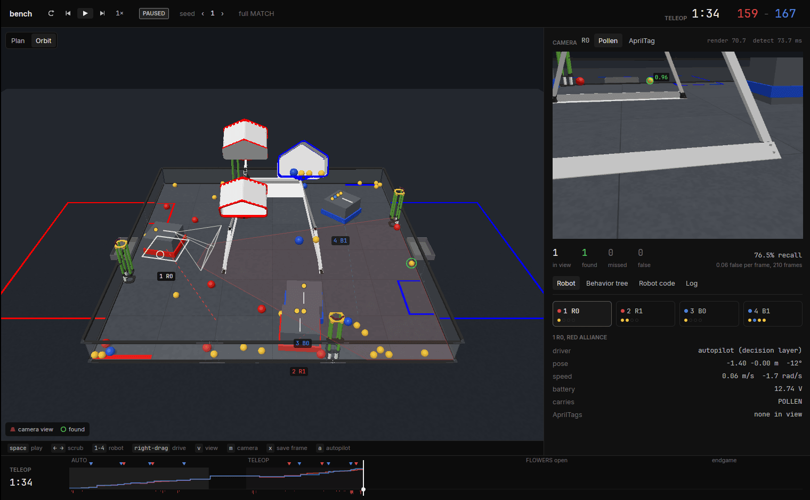
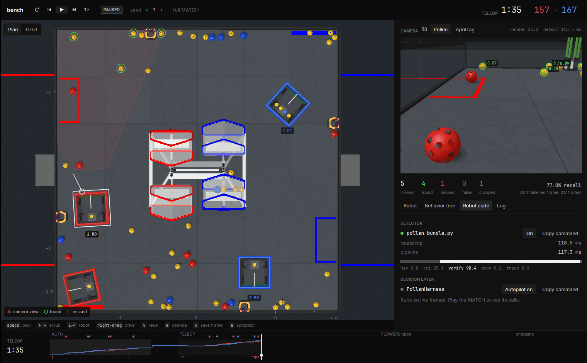

# bench

The BIOBUZZ simulator as a native app. It plays the same MATCH as the web simulator, headless in Node, and renders
the FIELD from the official field CAD. It also renders what a robot's camera sees, with exact labels for every ball,
so camera code and decision code can run against real MATCH play.



## Run it

You need Rust, Node.js 20 or later, and `npm install` in the simulator's checkout.

```
cd bench
cargo run --release
```

| Input | Action |
| --- | --- |
| Space | Start, pause, or resume |
| Left, right (Shift for 5 s) | Step back or forward through the MATCH |
| End or L | Follow the newest frame |
| Click a robot, or 1 to 4 | Select a robot |
| Right-drag on the FIELD | Drive the selected robot to a spot, facing the drag direction |
| Esc | Give the robot back to the planner |
| V | Switch between the plan view and the orbit view (drag to turn it, scroll to zoom) |
| M | Switch between the pollen camera and the AprilTag camera |
| X | Save the frame on screen with its labels to `~/bench-datasets/frames` |
| [ and ] | Slower, faster |
| R, N | Replay the seed, next seed |

Click the score for both alliances' breakdown. Hover the timeline for the score and the TIPS at that moment. Drag the
edge of the right column to make the camera larger.



## Robot code

```
cargo run --release -- \
  --camera-json path/to/camera.json \
  --detector "python3 bench/plugins/snapscript.py path/to/pollen_snapscript.py" \
  --harness "java -cp path/to/classes PollenHarness"
```

Commands run in the simulator's checkout. `plugins/snapscript.py` runs a Limelight SnapScript unchanged. With a
detector, the camera view and the FIELD mark each floor POLLEN it found (green) or missed (red dashes), and each false
detection (red), and the timeline marks frames with misses. Without one, a perfect camera built from the labels feeds
the decision layer, so the decisions can be tested apart from detection.

With a decision layer, the FIELD shows its tracks and target, and A hands the selected robot to an autopilot that
drives to the target's intake pose. When the robot is full, the planner launches, and the autopilot takes it back.
The formats are in [PROTOCOL.md](PROTOCOL.md).



## Your robot

```
cargo run --release -- --robot-model path/to/robot.glb --model-robots 0,1 --turret
```

The robots you name (0 and 1 are red, 2 and 3 are blue) are drawn from the GLB inside alliance bumpers, and the sim
sizes them to its drivetrain footprint. `--turret` gives them a turret shooter. To make the GLB from an Onshape STEP
export of the robot's assembly, run these from the simulator's checkout, with FreeCAD installed:

```
python3 bench/tools/step-colors.py robot.step colors.json
freecadcmd -c "import sys; sys.argv=['x', 'robot.step', 'robot.parts']; exec(open('bench/tools/step-to-parts.py').read())"
node bench/tools/parts-to-glb.mjs robot.parts colors.json robot.glb
```

`parts-to-glb.mjs` turns the robot so that its intake faces forward. Set `FRONT=+x`, `-x`, `+z` or `-z` if it picks
the wrong end. Keep your team's CAD out of this repository.

## Training data

```
cargo run --release -- export --seeds 1-20 --every 0.5 --mount pollen --out ~/bench-datasets/run1
```

This plays each seed headless and writes every robot's camera frame as a PNG, with one line per frame in
`labels.jsonl`: the camera pose and intrinsics, and for each ball in view its kind, image circle, range, how much of
it is visible, and whether it is a target (floor POLLEN outside the FLOWERS within 3.5 m).
